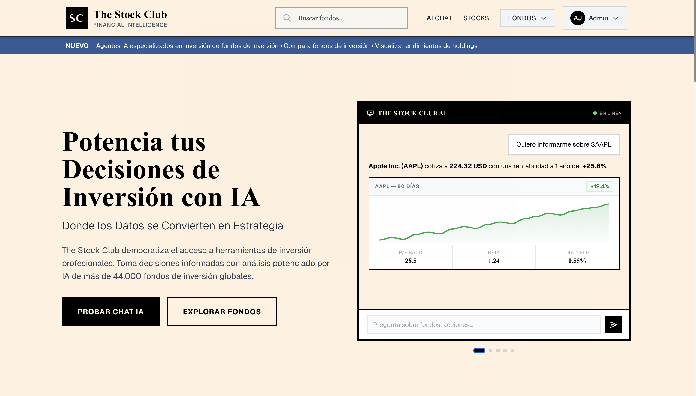
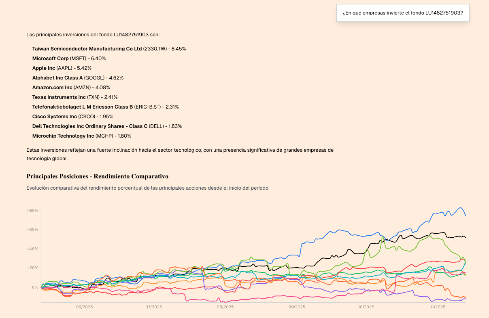
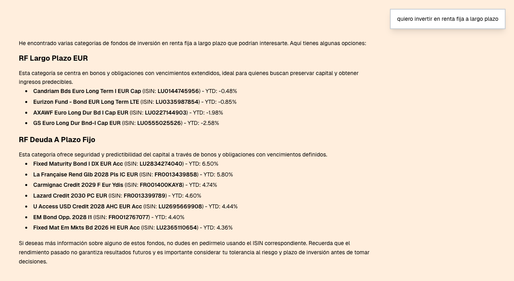
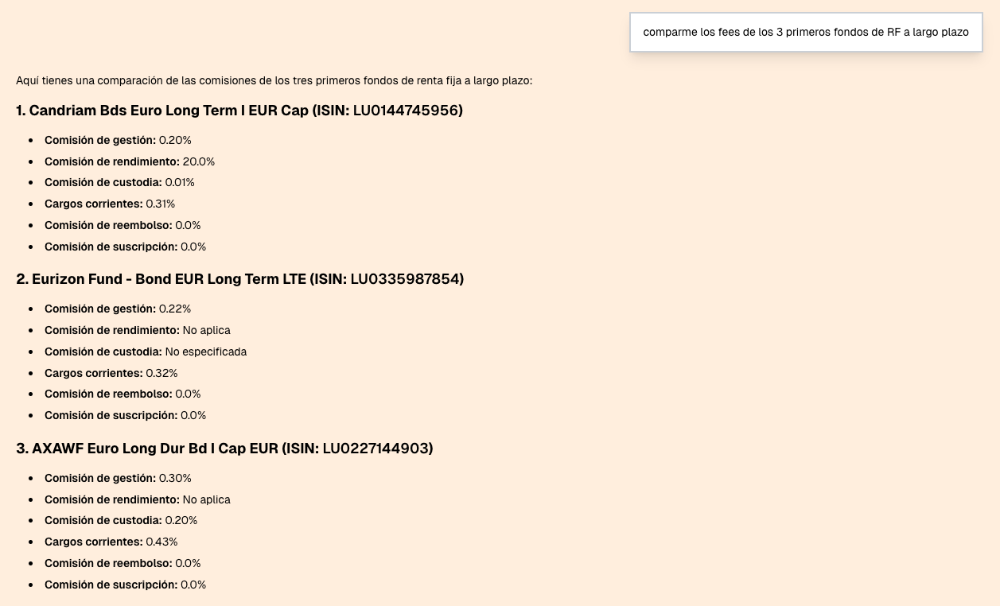

# TheStock.Club

Financial intelligence platform for investment fund and stock analysis, powered by an AI agent that can query, compare, and analyze over 44,000 funds in real time.

## At a Glance

| | |
|---|---|
| **Total Funds** | 44,351 |
| **Categories** | 247 |
| **Stocks** | Global coverage across 57 countries |
| **AI Agent** | Natural language queries with tool calling |

## Screenshots

  

  

  

  

## AI Agent

The core of TheStock.Club is a conversational AI agent that understands financial queries in natural language and calls specialized tools to fetch and analyze data. It is built with LangChain and GPT-4o.

### Tools

| Tool | What it does |
|---|---|
| `return_fund_info` | Looks up a fund by ISIN and returns detailed info (performance, category, holdings) |
| `return_stock_info` | Looks up a stock by ticker and returns financials and company profile |
| `return_best_ytd_fund` | Returns the top-performing funds year-to-date |
| `return_best_last_90d_fund` | Returns the top-performing funds over the last 90 days |
| `return_top_holdings` | Lists the top holdings of a fund |
| `return_funds_holding_stock` | Finds which funds hold a given stock |
| `search_funds_by_category` | Semantic search across 247 fund categories using pgvector embeddings |
| `search_stocks_by_sector_country` | Filters stocks by sector, country, or both |
| `calculate_fund_volatility` | Computes risk and volatility metrics for a fund |
| `analyze_drawdowns` | Analyzes max drawdown, recovery periods, and downside risk |
| `return_fund_comparison` | Side-by-side comparison of multiple funds |
| `return_funds_fees` | Compares fee structures across funds |

The agent decides which tools to call based on the user's message. Responses can include **artifacts** -- structured data that the frontend renders as interactive components (charts, tables, fund cards) alongside the text response.

## Tech Stack

**Backend:** FastAPI, SQLAlchemy 2.0, PostgreSQL + pgvector, LangChain, Alembic

**Frontend:** Next.js 15, React 19, Tailwind CSS, Radix UI, @visx charts, next-intl

## Database initialization

Database initialization creates missing tables but does not add missing indexes to existing tables. Existing indexes and data are left unchanged; use a reviewed migration if an existing table needs an index.
